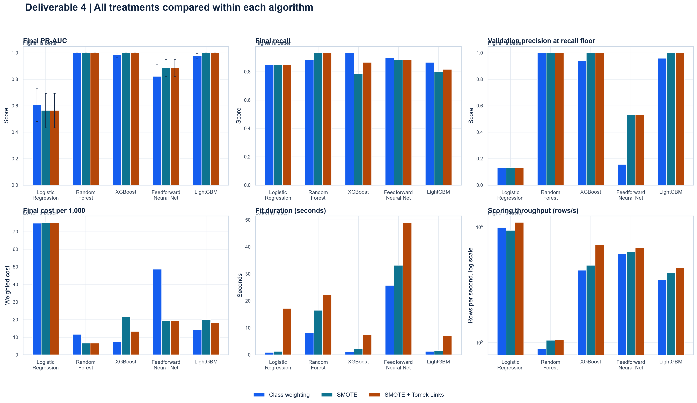
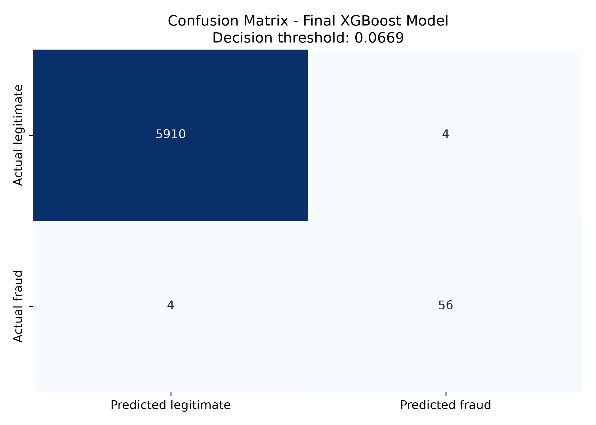
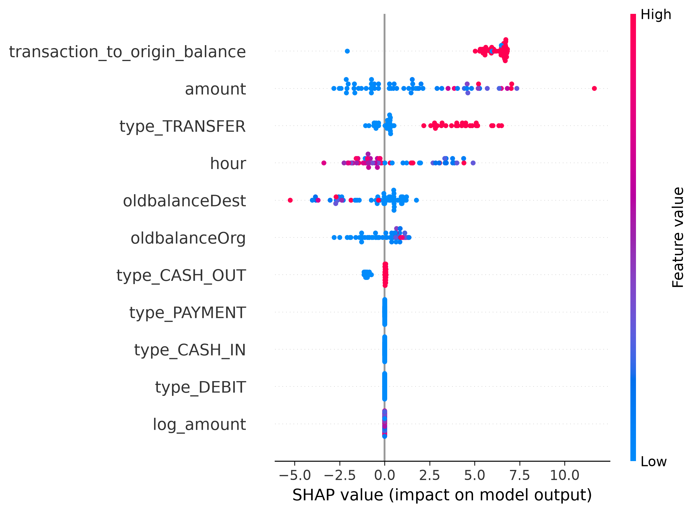
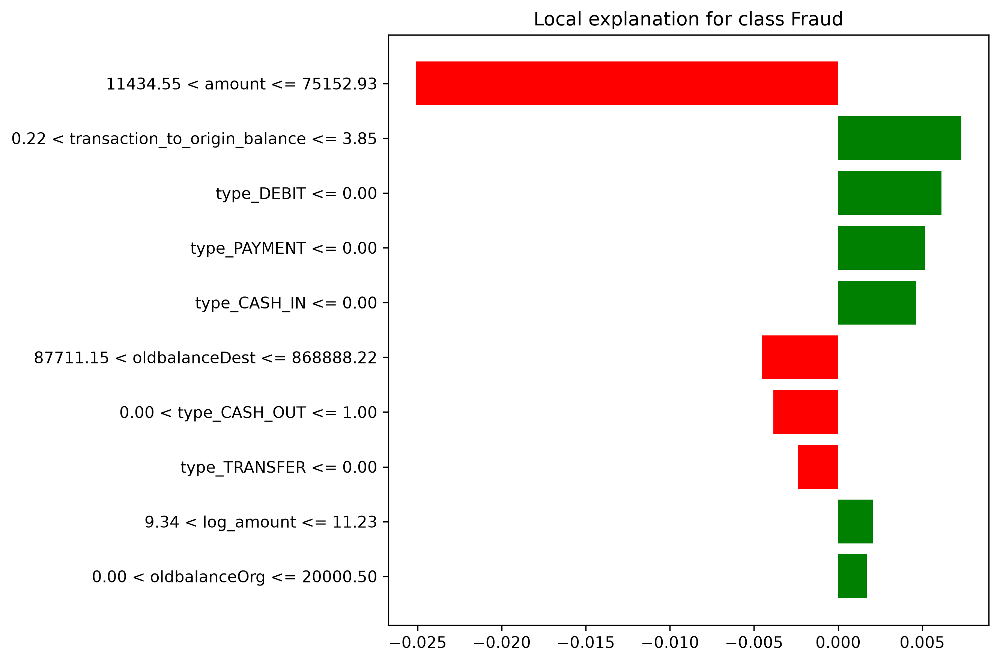

# Deliverable 6: Conclusion and Recommendations

## Mobile Money Fraud Detection with PaySim

**Portfolio project:** ITDPA3-34 · Group 3  
**Evidence basis:** Main-branch implementation and saved evaluation artifacts  
**Evaluation run:** `a0c5812936ac`, recorded 9 October 2026

## 1. Project Summary — 10 marks

### 1.1 Scope and objectives

This project explored whether supervised machine learning could help identify potentially fraudulent mobile-money transactions in the PaySim dataset. The central problem established in Deliverable 3 was to distinguish rare fraudulent activity from legitimate transactions in a large transaction stream, while balancing missed fraud against unnecessary alerts. The intended result was a reproducible comparison of models and a review aid for analysts, rather than an autonomous decision system.

The project objectives were to understand and prepare the data; create predictive transaction features; compare classification algorithms and imbalance treatments; evaluate performance on unseen data using metrics appropriate for rare fraud; explain model outputs; and make results accessible through a usable software demonstration.

### 1.2 Project method and work completed

The project used the synthetic PaySim mobile-money dataset, which contains 6,362,620 transactions, 11 columns, and 8,213 fraud labels (approximately 0.129%). The saved full-file data-quality report records zero missing values, invalid numeric values, non-finite values, negative amounts or balances, invalid labels, unexpected transaction types, and duplicate records. The quality report therefore supports the validity of the checked source snapshot; it does not establish that synthetic transactions represent the full range of live payment behavior.

The pipeline validated the entire source file, then selected a deterministic, label-stratified sample of 200,000 rows for modelling with random state 42. Those rows were separated chronologically by `step`: steps 1–407 for training (187,968 rows, 146 fraud), 408–563 for validation (6,058 rows, 52 fraud), and 564–743 for final testing (5,974 rows, 60 fraud). Keeping complete time steps in a single partition avoids training on later periods and testing on earlier ones. The final test period was reserved for reporting and did not select the model or decision threshold.

The predictive feature set uses transaction type, amount, the sender’s starting balance, and the recipient’s starting balance, plus hour of day (`step % 24`), log amount (`log1p(amount)`), and amount divided by sender starting balance plus one. Transaction type is one-hot encoded. Numeric values are scaled for Logistic Regression and the feedforward neural network. Customer identifiers, absolute step as a predictor, post-transaction balances, `isFlaggedFraud`, and the target are excluded from model inputs. These choices keep the model focused on information intended to be available before the transaction outcome and reduce the risk of memorization or target leakage.

Five model families—Logistic Regression, Random Forest, XGBoost, a feedforward neural network, and LightGBM—were compared with three imbalance strategies: class weighting, SMOTE, and SMOTE combined with Tomek links. This produced 15 algorithm-treatment pairings. Preprocessing and resampling were kept in model pipelines, with resampling applied during training only. The validation period was used to set a threshold for each pairing: the threshold maximizes precision while meeting the project’s minimum recall target of 90%. The selected pairing was then chosen by validation weighted error cost, assigning a project-policy cost of 10 to a false negative and 1 to a false positive.

The main-branch implementation connects the pipeline to a Streamlit interface with six sections: project overview, model comparison, visual analysis, explainability, transaction scoring, and alert triage/cost simulation. Transaction scoring requests pre-transaction fields and applies the saved model and validation-derived threshold. The simulator estimates a possible queue and cost from validation precision and recall plus user-supplied assumptions; it is not a prediction of a real queue, an evaluation of a new set of transactions, or a production forecast.

### 1.3 Major outcomes

The selected model was XGBoost with class weighting at a threshold of approximately 0.06693. The final test metrics were 93.3% precision, 93.3% recall, 93.3% F1, 0.9999 ROC-AUC, 0.9862 PR-AUC, and a Brier score of 0.00155. On the 5,974-row final window, the confusion matrix records 5,910 true negatives, four false positives, four false negatives, and 56 true positives. Under the project’s 10:1 false-negative/false-positive cost assumption, this gives a weighted test cost of 44.

The saved evidence also includes full-source quality checks, a 15-pair comparison, threshold and run metadata, probability-band summaries, a confusion matrix, performance and Pareto dashboards, a PR-AUC heatmap, SHAP and LIME illustrations, a scoring application, and a recorded automated test log. These are meaningful milestones for an academic prototype. The portfolio does not contain documented stakeholder feedback, a controlled live-system pilot, or evidence that the application is integrated into a payment service, so no such outcomes are claimed.

### 1.4 Planned versus delivered approach

Deliverable 3 proposed a supervised binary classifier and a comparative study. Those central choices were carried into the implementation. The final workflow changed some of the details as the data and intended use became clearer:

| Deliverable 3 plan | Main-branch implementation and saved evaluation |
| --- | --- |
| Use PaySim to study labelled mobile-money fraud | Used the 6.36-million-row synthetic PaySim source and validated its recorded schema and values. |
| Compare Logistic Regression, Random Forest, XGBoost, and a neural network; other planning sections also mention Decision Tree | Compared Logistic Regression, Random Forest, XGBoost, a feedforward neural network, and LightGBM. Decision Tree is not among the saved comparisons. |
| Explore class weighting, under-sampling, and oversampling, including SMOTE and NearMiss in different planning passages | Compared class weighting, SMOTE, and SMOTE plus Tomek links. NearMiss was not part of the recorded 15-pair comparison. |
| Consider random stratified splitting and cross-validation | Used chronological training, validation, and test windows by transaction step. This tests a later time period, but the saved evidence is one sampled temporal holdout rather than repeated rolling-origin evaluation. |
| Investigate balance changes and other behavioral features | Used pre-transaction inputs and derived hour, log amount, and transaction-to-origin-balance ratio. Post-transaction balance changes were excluded from predictors. |
| Deliver a usable model comparison and fraud-scoring demonstration | Added a modular command-line workflow, saved estimators and reports, example transactions, and the Streamlit interface. This demonstrates a prototype; it does not establish production readiness. |

The main-branch D4 summary and D5 evidence refer to the same saved baseline, so this report follows one continuous results narrative. The original planning, the implementation path, and the later testing and explainability evidence are considered together.

## 2. Evaluation of Project Outcomes — 10 marks

### 2.1 Achievement against objectives

The project substantially achieved its academic objectives: the source data were checked; a leakage-conscious feature pipeline was implemented; multiple model and imbalance-treatment combinations were compared; the decision threshold was selected on validation data; performance was measured on a later test period; and results were exposed in figures and an interactive application. The principal methodological improvement over the initial proposal was the use of time-ordered partitions. This better reflects the intended question—whether earlier transactions can help identify later fraud—than a random split would.

The saved test result is encouraging within the benchmark. The selected operating point identified 56 of 60 fraud cases in the sampled final period while raising four legitimate transactions for review. Its strong ranking scores indicate that fraud and non-fraud were highly separable in this sample. These results support the usefulness of the pipeline as a prototype and justify further controlled evaluation.

They do not show that the model will deliver the same performance on live transactions. Only 200,000 of 6,362,620 source rows were modelled; the final period contained 60 fraud cases; and the data are synthetic. The evidence does not measure real financial losses avoided, customer inconvenience, investigator workload, drift, or performance across organizations or customer groups. A high ROC-AUC or PR-AUC on this sample cannot remove those limits.

### 2.2 Performance, model choice, and errors

The decision threshold of 0.06693 was selected on validation, where the chosen pairing recorded precision of 94.1%, recall of 92.3%, and weighted cost of 43. It met the configured recall floor while keeping validation cost low. On the final test window, performance was:

| Measure | Saved result | Interpretation |
| --- | ---: | --- |
| Test transactions | 5,974 | Sampled transactions in the latest chronological window |
| Actual fraud cases | 60 | Positive-class denominator for recall |
| True positives / false negatives | 56 / 4 | 56 fraud cases were flagged; four were missed |
| True negatives / false positives | 5,910 / 4 | Four legitimate cases were flagged for review |
| Precision / recall / F1 | 93.3% / 93.3% / 93.3% | Threshold-based performance at the saved operating point |
| ROC-AUC / PR-AUC | 0.9999 / 0.9862 | Ranking performance across score thresholds |
| Brier score | 0.00155 | Probability score error summary; lower is better |
| Weighted test cost | 44 | 4 missed fraud × 10 plus 4 false alerts × 1 |

The model was chosen using validation cost, not by selecting whichever pairing looked best on the final test. For example, Random Forest with SMOTE plus Tomek links recorded test cost 40 in this sample, but its validation cost was 50 compared with 43 for the selected XGBoost/class-weight pairing. Choosing it after observing the test outcomes would use the held-out data for selection and make the reported test result optimistic. Keeping the selection rule validation-based is therefore an important part of the evaluation design.

The saved comparison reports hourly-bootstrap 95% intervals of approximately 85.1%–100% for precision, 86.1%–98.6% for recall, and 96.3%–99.9% for PR-AUC. These intervals resample whole time steps and communicate uncertainty associated with this test window. They do not account for the full shift from synthetic data to live operations, and the interval for recall is consistent with a meaningful range around the point estimate.

The saved probability bands are Low below 1%, Medium from 1% to below 5%, and High at or above 5%. For the selected pairing, the low band contained 5,908 transactions with no observed fraud; the medium band contained six transactions with four fraud cases; and the high band contained 60 transactions with 56 fraud cases. The medium-band percentage is based on only six cases, so it is highly unstable. These configurable bands are exploratory groupings, not validated risk policy, and a model score should not automatically be read as a real-world probability.

Accuracy is not a sufficient measure for this problem. With fraud at about 0.129% in the source, a trivial model predicting every transaction as legitimate would be correct on roughly 99.87% of source rows while detecting no fraud. Precision, recall, PR-AUC, the confusion matrix, and an explicit cost assumption provide a more decision-relevant account. The cost ratio remains a project assumption; operational costs require review with the people who would bear the consequences.

### 2.3 Interpretability, robustness, fairness, and impact

The saved SHAP summary covers 60 observations and reports the largest mean absolute attributions for `transaction_to_origin_balance` (about 6.16), `amount` (2.76), `type_TRANSFER` (2.14), and `hour` (1.73). This provides a view of which features influenced model output in that explanation sample. It does not show that these features cause fraud, nor that the same ordering will hold across another time period or a different population.

The LIME evidence includes a legitimate example with a fraud score of approximately 0.928, well above the saved threshold. This illustrates why the system should route high scores to review rather than treat a score as proof. It also gives a concrete false-positive case for future error analysis. SHAP and LIME help inspect model behavior, but they do not certify fairness or correctness.

Robustness evidence is limited. The chronological holdout, data checks, reproducible sampling, and training-only resampling are useful safeguards, but the artifacts do not record repeated temporal windows, independent external data, adversarial tests, or a systematic perturbation study for outliers and data shifts. The single saved test cannot establish stability over changing fraud behavior.

No demographic fairness analysis is present, and synthetic data do not establish how error rates would differ for real customer groups. Therefore this project cannot claim that the model is fair or that it has no disparate impact. Real financial data would require an authorized, privacy-conscious fairness assessment and accountable human review. The potential social value is earlier fraud detection; possible harms include unnecessary transaction reviews, delays, account restrictions, and missed fraud. Neither net impact nor business value has been measured in the saved artifacts.

### 2.4 Dashboard and visual evidence

The visual set supports different questions: class distribution establishes the scale of imbalance; the performance dashboard compares model-treatment metrics and runtime; the heatmap compares PR-AUC; the confusion matrix shows the selected operating point; the probability-band map summarizes observed fraud by score band; and the Pareto dashboard exposes quality, speed, recall, and cost trade-offs. In the Pareto figure, labels overlap in dense regions, so it is better treated as an exploratory comparison than as a precise model lookup. The performance dashboard title identifies it as Deliverable 4, consistent with the baseline comparison carried into the later evaluation.

*Figure 1. The saved dashboard compares PR-AUC, recall, validation precision at the recall floor, test cost, fit duration, and local scoring throughput. The treatment columns should be interpreted together with validation selection and test uncertainty.*

*Figure 2. The final-window confusion matrix shows four false positives and four false negatives at the saved threshold.*

*Figure 3. SHAP summaries indicate feature contributions for the sampled explanation set; they are model explanations, not causal findings.*

*Figure 4. The LIME example is a legitimate transaction assigned a high fraud score, highlighting the need for human review and false-positive analysis.*

### 2.5 Reproducibility and validation status

The repository separates data validation, feature generation, preprocessing, estimators, training, evaluation, prediction, visualization, and the application into reusable modules. The README documents environment setup, the expected location of the excluded raw CSV, preprocessing and training commands, output files, evaluation policy, and application launch. Random state 42, the chronological boundaries, threshold policy, source counts, and run metadata are saved with the result.

The saved pytest transcript records 20 passing tests covering data validation and sampling, evaluation metrics and threshold selection, feature behavior, and training/prediction behavior. The main branch also contains four targeted leakage-audit tests covering forbidden predictors, chronological partitions, training-only preprocessing, and resampling scope. The saved 20-test transcript predates that added audit file; the repository documents how to run those four tests, but there is no later saved transcript showing a combined run. This report therefore describes the test evidence as recorded and does not claim a fresh test execution.

## 3. Lessons Learned — 10 marks

### 3.1 Method choices should reflect the decision setting

The project began with a proposed random stratified split and possible cross-validation. The saved implementation instead partitions by transaction time and uses a distinct validation period for threshold selection. This is a stronger match for detecting future transactions from historical data. It also revealed that validation is not a formality: the operating threshold and chosen pairing depend on the intended recall target and error costs, not on a universal default of 0.5.

### 3.2 Rare-event performance needs more than accuracy

The dataset’s 0.129% fraud prevalence makes accuracy misleading. A model can appear highly accurate while missing every positive case. Comparing precision, recall, PR-AUC, false-positive and false-negative counts, and explicit policy cost made the trade-off visible. The project also showed why test metrics must not be used to choose the winner: a pairing with the lowest observed test cost was not the one with the best validation cost.

### 3.3 Leakage control belongs in the pipeline design

The initial proposal considered post-transaction balance changes and the simulator fraud flag. The implemented feature set excludes those fields because they may reveal the transaction outcome or information unavailable at the scoring point. Identifiers are excluded to reduce account memorization. Keeping preprocessing and resampling inside training pipelines helps preserve the boundary between training and held-out data. This is a reusable lesson for any predictive system: feature availability and split order should be specified before comparing metrics.

### 3.4 Synthetic benchmark strength is not deployment evidence

The saved XGBoost result is strong on this PaySim sample, but the test window contains only 60 fraud cases and the data are synthetic. The model’s apparent separation does not establish generalization to a real payment provider, unseen attack strategies, or new populations. Further validation requires evidence outside the single benchmark split and a review process designed around actual operational costs.

### 3.5 Interpretability and dashboards need an operator context

Global and local explanation plots give reviewers a way to inspect model behavior, and the LIME example makes a high-scoring legitimate transaction concrete. That is useful for error analysis; it does not convert a score into proof. Visuals and probability bands are easier to misuse when small denominators, uncertainty, and threshold policy are not visible alongside them. A review interface should show counts, operating assumptions, score meaning, and an escalation route.

### 3.6 Prototype integration is a milestone, not an operational pilot

The modular code and Streamlit app make the project inspectable and demonstrate scoring without training at app launch. The cost simulator is useful for exploring assumptions, but it uses validation metrics and hypothetical volume, prevalence, capacity, and costs. It cannot validate service behavior or financial impact. Future evaluation should include the full input-to-review workflow, latency under realistic load, analyst comprehension, and safe handling of missing or stale inputs.

## 4. Recommendations — 20 marks

### 4.1 Proposed improvements

1. **Keep a clear, reproducible baseline.** Preserve the current main-branch run metadata, model, comparison table, threshold, source snapshot details, and figures together. Make reports identify the source run and ensure every dashboard number can be traced to its saved CSV or JSON. This supports portfolio review and prevents later updates from silently changing the comparison basis.

2. **Broaden temporal validation before drawing general conclusions.** The saved test period is one later time window. A future study should use rolling-origin or multiple chronologically separated evaluation windows and report variation in precision, recall, PR-AUC, calibration, and error cost. This can reveal whether performance depends on a narrow time slice.

3. **Test probability quality and operating policy.** Retain Brier score, but add reliability diagrams and calibration assessment on appropriate held-out periods. Review probability-band boundaries and the 90% recall floor with domain stakeholders. Replace the 10:1 error ratio with measured or explicitly approved operational costs before using it to inform decisions. Continue choosing thresholds on validation data, never on the final test window.

4. **Strengthen error and robustness analysis.** Examine false positives and false negatives by transaction type, amount range, time step, and other lawful operational slices. Test input perturbations, unusual but valid balances, missing/invalid fields, and temporal drift. Record the number of cases in every slice and uncertainty so small groups are not overinterpreted.

5. **Improve the visual review experience.** Reduce overlapping model labels in the Pareto figure, show denominators beside probability-band rates, improve the legibility of the local explanation, and make captions state the run, split, and threshold. Provide an accessible text/table alternative for every key figure. Keep scenario estimates visually distinct from observed test results.

6. **Expand explainability evaluation.** Check whether SHAP and LIME explanations are stable across time windows and similar transactions. Ask reviewers whether explanations help them investigate cases, and document when the explanation is not reliable. Do not describe feature attribution as causation or as a definitive fraud reason.

7. **Add application-level validation.** Extend the recorded unit coverage with end-to-end checks for valid and invalid transaction inputs, incompatible or missing model artifacts, stale report files, startup behavior, accessibility, and safe error handling. Conduct a small documented usability exercise with synthetic examples before proposing a human-reviewed pilot.

### 4.2 Future research and development

**Generalization across time and datasets.** Evaluate the frozen baseline over multiple later windows, then—only with authorization—compare it with an independently sourced or provider-approved dataset. The research question is whether the apparent detection quality persists across shifts in transaction mix and fraud behavior.

**Thresholds under realistic operational capacity.** Use a representative authorized workload to measure the alert volume and investigation yield at different thresholds. Compare outcomes under realistic review capacity and approved cost assumptions. This would make the cost simulator’s assumptions testable and help distinguish a technically high-performing model from a workable review policy.

**Human explanation and review quality.** Test whether global and local explanations improve reviewer understanding, consistency, and error detection. A study should compare review with and without explanations, include difficult false-positive examples, and measure whether users understand that a score is not proof of fraud.

**Fairness and customer impact.** Define appropriate fairness questions with privacy, legal, and domain specialists. If lawful and suitable data are available, measure error rates and review outcomes for relevant populations with adequate sample sizes and uncertainty reporting. If such analysis cannot be performed, document the limit and do not make a fairness claim.

### 4.3 Implementation considerations

The current system should remain a portfolio prototype and decision-support demonstration. Before any live pilot, the organization would need to define an authorized data source, source-field timing, latency and volume requirements, interface security, model ownership, reviewer workflow, customer safeguards, and a rollback process. Local batch throughput does not establish a service-level capacity because it excludes feature ingestion, network, concurrency, logging, queues, and analyst handling.

Monitoring should include input schema and missingness, score and transaction distributions, alert volume, mature-label precision and recall, calibration, service latency and errors, reviewer workload, and relevant group outcomes where lawful. Each metric needs a named organizational owner, review cadence, thresholds for action, and a response plan. A safe fallback should route cases to existing controls or manual review if data, model, or service checks fail.

Every candidate model should be versioned with its data snapshot, feature schema, code revision, environment, threshold, validation report, approval record, and rollback artifact. A future model should be compared with the frozen baseline under the same evaluation protocol. A better score on one test window alone should not be enough to replace the baseline.

### 4.4 Ethical and responsible AI practices

Keep a human accountable for decisions that could restrict or delay access to funds. Treat a high score as a prompt for authorized investigation, not a finding of wrongdoing. Provide a route to review or contest an adverse outcome, record overrides, and monitor false-positive burden as well as missed fraud. Explain the limits of scores and explanations to analysts and affected users in language appropriate to the context.

Before using real transaction data, conduct a documented impact assessment with domain, privacy, security, and legal reviewers. Define permitted purposes, prohibited automated actions, access to explanations, retention, incident handling, and responsibility for model changes. Evaluate fairness explicitly where suitable lawful data exist; do not infer fairness from synthetic data or the absence of protected attributes.

### 4.5 Data governance and compliance

The current evidence is based on synthetic PaySim data. A future implementation using real transaction or account information would require an organization-specific legal and governance review. Where applicable, review the [Protection of Personal Information Act (POPIA)](https://www.gov.za/documents/protection-personal-information-act) and the [EU General Data Protection Regulation](https://eur-lex.europa.eu/eli/reg/2016/679/oj) with qualified advisors; applicability depends on the processing context and jurisdiction.

Establish data minimization, documented purpose and authority, role-based access, encryption, retention and deletion schedules, secure secrets handling, audit records, and breach response. Maintain lineage from source data through features, model, threshold, decision, and review. Assign responsible roles for data stewardship, access approvals, model-risk review, incident response, and customer redress. Define criteria for revalidation, updates, suspension, rollback, and retirement before any deployment.

### 4.6 Prioritized next steps

| Priority | Action | Evidence of completion |
| --- | --- | --- |
| 1 | Preserve and document the main-branch baseline and its artifacts as the common reference for the project. | Run manifest, model metadata, figures, and report values agree. |
| 2 | Conduct additional chronological evaluation windows and calibration/error analysis when new evaluation is approved. | Reproducible window-level metrics, uncertainty, and documented threshold review. |
| 3 | Validate explanation stability and dashboard usability with representative reviewers using synthetic or authorized data. | Recorded tasks, findings, and changes to explanations and visual design. |
| 4 | Complete privacy, security, fairness, operational-capacity, and human-review design before any live-data pilot. | Approved governance and operational readiness review. |
| 5 | If approved, begin with a shadow or human-reviewed pilot and predefined stop/go criteria. | Pilot report, incident record, customer safeguards, and independent decision. |

## Conclusion

The main-branch project carries the original Deliverable 3 question through to a reproducible fraud-detection prototype, a chronological model comparison, saved results, model explanations, and a Streamlit review interface. The selected XGBoost/class-weight model achieved 93.3% precision and recall on the saved 5,974-transaction test window, detecting 56 of 60 fraud cases with four false alarms. The same evidence shows why the result must be kept in context: the model used a 200,000-row sample from a synthetic dataset, the test contains a limited number of fraud cases, and the operating costs are assumptions rather than measured business costs.

The project’s strongest contribution is the connected workflow: explicit data checks, pre-transaction feature design, train-only imbalance handling, validation-based model and threshold selection, chronological testing, interpretable evidence, and an interactive demonstration. Its next stage should protect that baseline while building stronger temporal, operational, fairness, and governance evidence. Until that work is complete, the model is suitable as a portfolio demonstration and a starting point for controlled study, not as an autonomous payment decision system.

## Main-branch evidence referenced

- Planning scope: `../../ITDPA3-34-Group3-Deliverable3.docx`
- Main workflow and methodology: `../README.md` and `../src/fraud_detection/`
- Main-branch evaluation summary: `../reports/training_summary.json` and `../reports/model_comparison.csv`
- Deliverable 5 saved evidence: `../evidence_deliverable_5/training_summary.json`, `data_quality.json`, `model_comparison.csv`, `model_comparison_key_metrics.csv`, `imbalance_strategy_comparison.csv`, `confusion_matrix_counts.json`, `probability_bands.csv`, and `interpretability_summary.json`
- Saved visuals: `../evidence_deliverable_5/figures/`
- Testing record and targeted checks: `../evidence_deliverable_5/pytest_results.txt`, `../tests/`, and the leakage-audit section in `../README.md`
- User-facing demonstration: `../app/streamlit_app.py` and `../examples/sample_transactions.csv`

